<h1>Hi, I'm Patryk 👋</h1>

<b>Patryk Broncel</b> · I build full-stack apps, automation tools and trading software.

  
  &nbsp;
  

<ul>
  <li>🎓 Third-year <b>MComp Computer Science with an Industrial Placement Year</b> student at the <b>University of Sheffield</b>. Graduating <b>2029</b>.</li>
  <li>💼 Looking for a <b>2027/28 software engineering industrial placement</b>.</li>
</ul>

<h2>Languages &amp; tools</h2>

<h4>Languages</h4>

   &nbsp;
  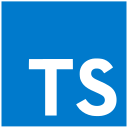 &nbsp;
   &nbsp;
   &nbsp;
  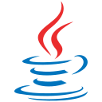 &nbsp;
  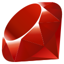

<h4>Frameworks &amp; tools</h4>

   &nbsp;
   &nbsp;
  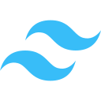 &nbsp;
   &nbsp;
   &nbsp;
   &nbsp;
   &nbsp;
   &nbsp;
   &nbsp;
  

<code>SQL</code> <code>TanStack Start</code> <code>Better Auth</code> <code>NATS JetStream</code> <code>Optuna</code> <code>Linux</code>

<h3>Selected projects</h3>

<a href="https://github.com/PatrykBr/Tradingview-Optimiser">
  <picture>
    <source media="(prefers-color-scheme: dark)" srcset="assets/repos/optimiser-dark.svg" />
    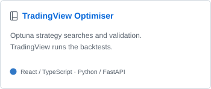
  </picture>
</a>
<a href="https://github.com/PatrykBr/bbf-site">
  <picture>
    <source media="(prefers-color-scheme: dark)" srcset="assets/repos/furniture-dark.svg" />
    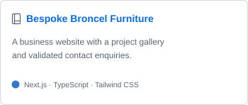
  </picture>
</a>
<a href="https://github.com/PatrykBr/afterglow-led">
  <picture>
    <source media="(prefers-color-scheme: dark)" srcset="assets/repos/afterglow-dark.svg" />
    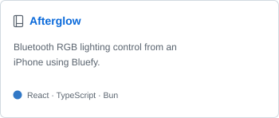
  </picture>
</a>
<a href="https://github.com/PatrykBr?tab=repositories&q=zed-">
  <picture>
    <source media="(prefers-color-scheme: dark)" srcset="assets/repos/zed-dark.svg" />
    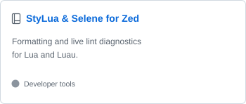
  </picture>
</a>

<a href="https://www.broncelfurniture.com">Bespoke Broncel Furniture live website</a> · <a href="https://github.com/PatrykBr/zed-stylua">StyLua</a> · <a href="https://github.com/PatrykBr/zed-selene">Selene</a>

<h3>Also building</h3>

  <picture>
    <source media="(prefers-color-scheme: dark)" srcset="assets/repos/tradesync-dark.svg" />
    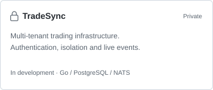
  </picture>
  <picture>
    <source media="(prefers-color-scheme: dark)" srcset="assets/repos/reset-dark.svg" />
    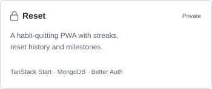
  </picture>

<h3>On GitHub</h3>

  <a href="https://github.com/PatrykBr?tab=overview">
    <picture>
      <source media="(prefers-color-scheme: dark)" srcset="assets/stats/activity-dark.svg" />
      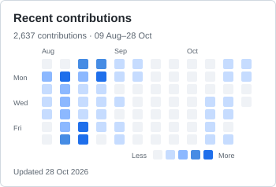
    </picture>
  </a>
  <a href="https://github.com/PatrykBr?tab=repositories">
    <picture>
      <source media="(prefers-color-scheme: dark)" srcset="assets/stats/languages-dark.svg" />
      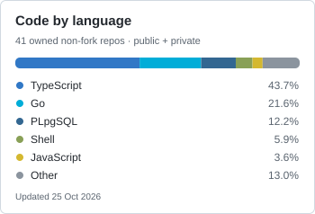
    </picture>
  </a>

